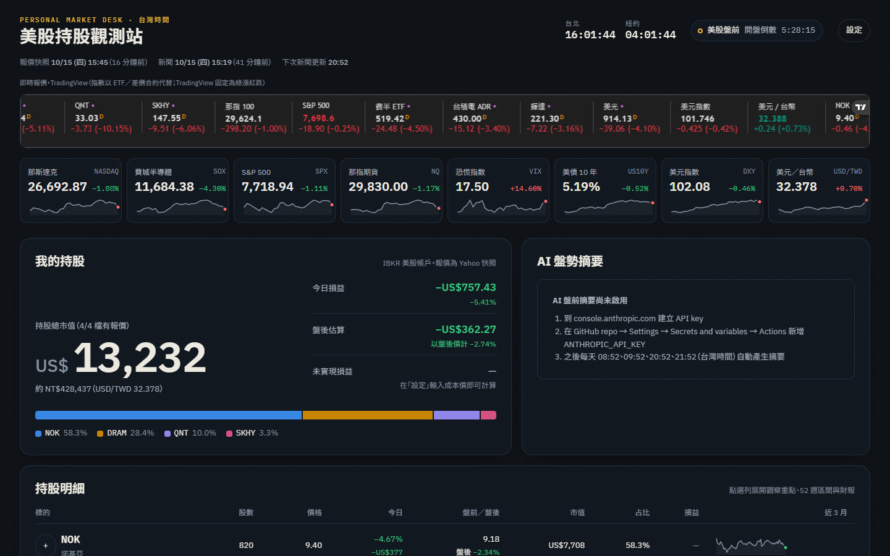

# 美股持股觀測站

個人美股儀表板：隨時看持股（NOK、DRAM、QNT、SKHY）、影響那斯達克與費城半導體的新聞、法說會（財報）與總經指標。
網站放在 GitHub Pages，資料由 GitHub Actions 定時抓取，不需要自己的伺服器。

**網址：<https://yan-wei-yu.github.io/finacial-world/>**



## 功能

| 區塊 | 內容 |
| --- | --- |
| 我的持股 | 總市值（美元／約當台幣）、今日損益、盤前／盤後估算、持股比重；可在「設定」輸入成本價看未實現損益 |
| 持股明細 | 每檔價格、漲跌、盤前盤後價、市值、近 3 個月走勢；點開看觀察重點、52 週區間、歷次 EPS |
| AI 盤勢摘要 | Claude 依最新新聞整理影響那指／費半的重點、對持股的影響、接下來要注意的事件（可用 Claude Pro／Max 訂閱，不必另買 API key） |
| 新聞 | Google News（中英文）、CNBC、MarketWatch、Yahoo Finance、鉅亨網，自動分成我的持股／半導體 AI／總經 Fed／世界大事／美股大盤，可依持股、語言篩選，標示「上次造訪後新增」 |
| 法說會與財報 | 持股與費半權值股（台積電、輝達、美光、ASML、三星…）、AI 資本支出大廠的財報日、EPS 與營收預估、最近一次 EPS 驚喜 |
| 總經 | 本週美國重要數據（CPI、PPI、非農…含預期與前值）、FOMC、韓國出口、台積電月營收、DRAM 合約價、QNT 閉鎖期 |
| 關鍵指標 | SK 海力士 ADR、台積電 ADR 相對本地股價的溢價 |
| 即時 | TradingView 即時報價帶、互動 K 線圖、經濟日曆 |

其他：台北／紐約雙時鐘、美股盤前／盤中／盤後／夜盤狀態與開盤倒數（含夏令時間與休市日）、紅漲綠跌（可切換）、深淺色主題、手機版。

## 更新時間（台灣時間）

| 內容 | 時間 |
| --- | --- |
| 新聞、財報、總經、AI 摘要 | 每天 08:52、09:52、20:52、21:52（讓 9 點、10 點與晚上 9 點、10 點打開時是新的） |
| 報價快照 | 美股交易日約 20:07 到隔天 05:52，每 15 分鐘 |
| 手動更新 | GitHub → Actions →「更新資料並部署網站」→ Run workflow |

GitHub 的排程在尖峰時段可能延遲幾分鐘到十幾分鐘。

## 常見調整

**修改持股**：在 GitHub 網頁打開 [`config/portfolio.json`](config/portfolio.json)，按鉛筆圖示修改 `shares`（股數），Commit 後約 2 分鐘網站就會更新。新增股票就複製一段 `holdings` 裡的設定，改 `symbol`、`name_zh`、`tv_symbol` 等欄位。

**成本價**：在網頁右上角「設定」輸入，只存在你自己的瀏覽器，不會上傳。也可以寫進 `portfolio.json` 的 `cost`（repo 是公開的，任何人都看得到）。

**新聞來源與關鍵字**：[`config/news.json`](config/news.json)；**財報追蹤名單、TradingView 代號**：[`config/watchlist.json`](config/watchlist.json)；**FOMC 與固定指標日期**：[`config/events.json`](config/events.json)。

## AI 盤勢摘要

兩種方式擇一，設定後每次新聞更新都會產生摘要。

**方式一：Claude Pro／Max 訂閱（不必另外付費）**

1. 在自己的電腦安裝 Claude Code（Windows PowerShell：`irm https://claude.ai/install.ps1 | iex`；
   macOS／Linux：`curl -fsSL https://claude.ai/install.sh | bash`），開新的終端機視窗。
2. 執行 `claude setup-token`，在跳出的瀏覽器頁面登入並同意，終端機會印出一串 token（有效一年，不會自動存檔，請直接複製）。
3. GitHub repo → Settings → Secrets and variables → Actions → New repository secret，名稱 `CLAUDE_CODE_OAUTH_TOKEN`，貼上 token。

排程會用固定版本的 Claude Code（[`tools/claude-code`](tools/claude-code/package.json)）產生摘要，關閉所有工具，只輸出摘要。
用量算在你的訂閱額度內（一天 4 次，每次約 6,000 個輸入 tokens）。token 到期後重新執行 `claude setup-token` 並更新 Secret。

**方式二：Anthropic API key（按用量付費）**

1. 到 [console.anthropic.com](https://console.anthropic.com) 建立 API key。
2. 新增 repository secret，名稱 `ANTHROPIC_API_KEY`（兩種都設定時優先用 API key）。
   每次約 6,000 個輸入 tokens、1,500 個輸出 tokens，費用依 Anthropic 官方定價計算。

預設模型是 Sonnet；想換模型可在同一頁的 Variables 新增 `CLAUDE_MODEL`（例如 `claude-opus-5-5`）。
摘要僅整理新聞，不提供買賣建議。

## 運作方式

```text
GitHub Actions（排程）
  └─ python -m pipeline.main --mode full|quotes
       ├─ 報價：Yahoo Finance（yfinance）→ site/data/quotes.json
       ├─ 新聞：RSS／Google News／鉅亨網 → 關鍵字分類、評分、去重 → site/data/news.json
       ├─ 財報：yfinance 財報日與預估 → site/data/earnings.json
       ├─ 總經：ForexFactory 本週數據＋固定日程 → site/data/macro.json
       └─ AI 摘要：Claude（訂閱 token 經 Claude Code，或 API key）→ site/data/summary.json
  └─ 部署 site/ 到 GitHub Pages
瀏覽器
  └─ 讀取 site/data/*.json，每 5 分鐘自動重新整理；TradingView 元件提供即時報價
```

- 新聞執行時會把資料 commit 回 repo（保留近 4 天新聞）；報價快照只部署、不 commit，避免歷史紀錄暴增。
- 任何一個資料來源失敗都不會影響其他區塊，失敗時沿用上一次的資料並在頁面標示。

## 已知限制

- 報價為 Yahoo Finance 快照，可能延遲約 15 分鐘；即時價格請看上方 TradingView 報價帶。
- TradingView 免費元件無法顯示那斯達克、費半、VIX 原始指數，報價帶以 ETF（SOXX）與差價合約（那指 100、S&P 500）代替；TradingView 固定為綠漲紅跌。
- 財報時間在公司正式公告前是 Yahoo 的預估；海外公司（諾基亞、SK 海力士、台積電…）以當地時間公布，頁面只標示盤前／盤後。
- QNT 閉鎖期日期依招股書 180 天推估。

## 本機開發

```bash
python -m venv .venv
.venv/Scripts/python -m pip install -r requirements-dev.txt   # macOS / Linux：.venv/bin/python
.venv/Scripts/python -m pipeline.main --mode full --no-summary  # 抓一次資料到 site/data
npm install
npm run serve                                                   # http://127.0.0.1:8000
```

測試：

```bash
.venv/Scripts/python -m pytest --cov   # 資料管線（覆蓋率門檻 80%）
npm test                               # 前端純函式
npx playwright test                    # 端對端（使用本機 Chrome）
```

## 專案結構

```text
config/        持股、追蹤名單、新聞來源與關鍵字、固定日程、總經中文名稱
pipeline/      資料管線（Python）
site/          網站（HTML/CSS/JS 模組，無建置步驟）；site/data/ 為自動產生的資料
tests/         管線測試（pytest）
tests-js/      前端純函式測試（node:test）
tests-e2e/     端對端測試（Playwright）
.github/       GitHub Actions：資料更新與部署、測試
```

## 免責聲明

本專案僅彙整公開資訊供個人參考，資料可能延遲或有誤，不構成任何投資建議。
